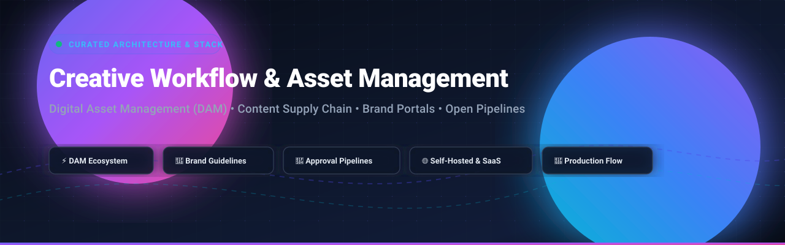

# 🎨 Awesome Creative Workflow & Asset Management

**The definitive curated index of SaaS platforms & open-source solutions for Digital Asset Management (DAM), Brand Management, Content Operations, and Creative Approval Pipelines.**

*Centralize assets • Enforce brand guidelines • Automate review & approval workflows • Streamline content supply chains*

**Last updated: October 2026**

---

## 📌 Table of Contents

- [🌐 Sector Overview & Market Dynamics](#-sector-overview--market-dynamics)
- [🏢 SaaS & Enterprise Hosted Platforms](#-saas--enterprise-hosted-platforms)
- [💻 Open-Source GitHub Projects](#-open-source-github-projects)
- [🏗️ Architectural Guidelines & Pipelines](#️-architectural-guidelines--pipelines)
- [🤝 How to Contribute](#-how-to-contribute)
- [☕ Support](#-support)
- [📈 Star History](#-star-history)
- [⚠️ Disclaimer](#️-disclaimer)

---

## 🌐 Sector Overview & Market Dynamics

The global Digital Asset Management (DAM) and Creative Workflow market is valued at **$5.5B to $8.9B in 2025–2026**, expanding at a robust Compound Annual Growth Rate (CAGR) of **~15–17%**. 

- **Ecosystem Fragmentation**: The broader industry is **moderately to highly fragmented**. Hundreds of specialized point solutions, vertical-specific creative tools, and cloud-native disruptors coexist to serve diverse requirements spanning mid-market marketing departments, game studios, and agency operations.
- **Enterprise Consolidation**: The top-tier market share remains concentrated among major enterprise cloud suites (notably Adobe, Bynder, and Sitecore) that command Fortune 500 digital asset supply chains with deep MarTech integrations and global governance.

---

## 🏢 SaaS & Enterprise Hosted Platforms

| Product | Description | Company Size (Revenue / Valuation) | Pricing | Free Tier / Free Trial Limits |
| :--- | :--- | :--- | :--- | :--- |
| **[Adobe Content Supply Chain / AEM Assets](https://business.adobe.com/products/experience-manager/assets.html)** | Enterprise content and digital asset management integrated with Adobe Creative Cloud. | **~$195B+ Market Cap** (~$21.5B+ annual revenue) | Starting at **~$25,000 to $40,000/year** (AEM Assets Prime entry tier; enterprise bundles reach $100,000+/year) | No permanent free tier; No self-serve trial (custom guided sandbox/PoC upon sales qualification) |
| **[Sitecore Content Hub](https://www.sitecore.com/products/content-hub)** | Unified content and digital asset management platform with workflow, localization, and omnichannel delivery. | **~$500M+ ARR** (~$1.2B+ PE valuation backed by EQT) | Starting at **~$25,000 to $45,000/year** (custom enterprise quotes based on modules and storage) | No permanent free tier; No self-serve trial (custom sandboxes provided only via partner/sales PoC) |
| **[Bynder](https://www.bynder.com/)** | Cloud DAM and brand management platform known for intuitive search, brand portals, and creative workflows. | **~$600M+ Valuation** (~$100M+ ARR; backed by Thomas H. Lee Partners) | Starting at **~$450/month** (~$5,400 to $9,000/year base; median enterprise contracts range $35,000–$40,000/year) | No permanent free tier; No self-serve free trial (guided demo and tailored consultation only) |
| **[Aprimo](https://www.aprimo.com/)** | Comprehensive marketing operations and DAM platform focused on content planning, production, and distribution. | **~$35M to $50M ARR** (acquired by Marlin Equity Partners, historically $90M–$525M transactions) | Starting at **~$1,667/month** (~$20,000/year baseline DAM subscription) | No permanent free tier; No self-serve free trial (guided live demo and customized PoC evaluation only) |
| **[censhare](https://www.censhare.com/)** | Universal content and digital asset management platform for multi-channel publishing and brand management. | **~$20M to $35M ARR** (~$29.6M total funding; backed by DuMont) | Starting at **~$1,000/month** (~$12,000/year for baseline configuration of ~5 named users) | No permanent free tier; No self-serve trial (evaluations require scheduled sales demo/PoC) |
| **[Celum](https://www.celum.com/)** | Enterprise digital asset and content management system emphasizing media libraries and collaboration. | **~$20M to $25M ARR** (Privately held, self-financed European DAM provider) | Starting at **~$850 to $1,500/month** (~$10,000 to $18,000/year entry enterprise tier) | No permanent free tier; No self-serve trial (available via requested sales demo and custom PoC) |
| **[BrandMaker (Uptempo)](https://www.brandmaker.com/)** | Marketing resource management and DAM suite covering asset management and campaign planning. | **~$20M to $30M ARR** (Part of Uptempo, backed by Rubicon Technology Partners) | Starting at **~$2,000/month** (~$24,000/year base deployment) | No permanent free tier; No self-serve free trial (personalized product demo only) |
| **[Frontify](https://www.frontify.com/)** | Brand management platform combining DAM, digital brand guidelines, templates, and collaboration. | **~$20M to $30M ARR** (~$80.6M total funding, Series C backed by Revaia & EQT) | Starting at **~$100 to $150/month** (~$1,200 to $1,800/year for Essentials tier; custom scaling by MAU) | No permanent free tier; **14-day free trial** (restricted to core brand guidelines & essential DAM features, standard cloud sandbox) |
| **[Wedia](https://www.wedia-group.com/)** | Enterprise DAM and content hub focused on brand consistency, media processing, and distribution. | **~$27M Valuation** (~€26M market cap on Euronext Growth; ~€13M–€14M annual revenue) | Starting at **~$1,200/month** (~$14,400/year entry configuration) | No permanent free tier; No self-serve trial (free demo and sandbox access upon qualification) |
| **[Storyteq](https://www.storyteq.com/)** | Creative automation and asset management platform specializing in video and omnichannel production. | **~$5M to $10M ARR** (Division of Inspired Thinking Group / ITG, ~$190M+ group revenue backed by Bridgepoint) | Starting at **~$2,150/month** (~€1,999/month billed annually) | No permanent free tier; No self-serve free trial (available via scheduled enterprise demo) |

---

## 💻 Open-Source GitHub Projects

Curated self-hosted and open-core projects for digital asset storage, creative collaboration, media indexing, and production pipelines. Ranked by GitHub star popularity:

- **[Immich](https://github.com/immich-app/immich)**   
  High-performance self-hosted photo and video management system featuring automatic backups, AI-driven facial recognition, clip indexing, and modern web & mobile clients. Ideal for media-heavy creative teams.

- **[PhotoPrism](https://github.com/photoprism/photoprism)**   
  AI-powered self-hosted media and digital asset platform. Leverages deep learning to tag and find photos, offers high-res RAW support, duplicate detection, and map-based metadata exploration.

- **[LibrePhotos](https://github.com/LibrePhotos/librephotos)**   
  Self-hosted, privacy-first photo management service with deep semantic search, facial recognition, video transcoding, and complete multi-user access control.

- **[Pimcore](https://github.com/pimcore/pimcore)**   
  Enterprise open-core framework combining Digital Asset Management (DAM), Product Information Management (PIM), MDM, and digital experience engines into a single extensible platform.

- **[Piwigo](https://github.com/Piwigo/Piwigo)**   
  Mature, extensible web-based photo and media gallery system. Offers granular access permissions, bulk asset metadata editing, extensive theme/plugin ecosystem, and REST API.

- **[DSpace](https://github.com/DSpace/DSpace)**   
  Turnkey institutional repository and digital asset management platform used globally by research institutions, libraries, and organizations for preserving rich multimedia assets and documents.

- **[Invenio](https://github.com/inveniosoftware/invenio)**   
  Framework for large-scale digital repositories and asset archives developed by CERN. Features petabyte-scale metadata modeling, elastic search indices, and distributed object storage.

- **[TACTIC](https://github.com/Southpaw-TACTIC/TACTIC)**   
  Dynamic enterprise workflow engine and asset management solution designed specifically for digital content production pipelines, VFX studios, and creative collaboration tracking.

- **[CollectiveAccess](https://github.com/collectiveaccess/providence)**   
  Configurable relational cataloguing and digital asset repository software built for cultural institutions, digital heritage, and specialized multi-format media archives.

- **[OpenAssetIO](https://github.com/OpenAssetIO/OpenAssetIO)**   
  Open-source interoperability standard enabling creative tools, DCC applications, and content management systems to communicate seamless asset references across production pipelines.

- **[Phraseanet / Phrasea](https://github.com/alchemy-fr/Phraseanet)**   
  Full-featured open-source web DAM with Elasticsearch indexing, AI-assisted tagging, automated media conversions, export pipelines, and granular rights management.

- **[AtroDAM](https://github.com/atrocore/atrodam)**   
  Modern single-page application (SPA) digital asset management system built on AtroCore. Supports automatic duplicate detection, asset relationships, batch metadata editing, and RESTful API integration.

- **[ResourceSpace](https://github.com/resourcespace/resourcespace)**   
  Time-tested open-source DAM system for enterprise images, video, brand collateral, and audio. Features robust metadata schemas, permission hierarchies, and automated transcoding.

- **[Artbucket](https://github.com/pwnera/artbucket)**   
  Modern self-hosted DAM and brand guideline manager. Treats design assets, rules, and portals as structured data, with REST APIs, CLI tooling, and Model Context Protocol (MCP) support for AI agents.

- **[Stash](https://github.com/nixentric/stash)**   
  Lightweight offline-first creative asset organizer and brand style manager tailored for digital artists, designers, and video editors with local caching and fast search.

---

## 🏗️ Architectural Guidelines & Pipelines

Building a tailored internal creative asset infrastructure:

1. **Enterprise Foundation**: Deploy **ResourceSpace**, **Pimcore**, or **AtroDAM** for core asset ingestion, metadata taxonomies, and permission boundaries.
2. **Production & Automation**: Integrate **TACTIC** or **OpenAssetIO** to automate production handoffs, reviews, and DCC software integration (Blender, Premiere, Photoshop).
3. **Brand Portals & Guidelines**: Utilize **Artbucket** or **Frontify** for external stakeholder portals, dynamic style guides, and brand governance.
4. **Media Archives & Search**: Pair with **Immich** or **PhotoPrism** for AI-accelerated visual search and mobile asset synchronization.

---

## 🤝 How to Contribute

Contributions are warmly welcomed! Help keep this directory current, accurate, and comprehensive.

1. 🍴 **Fork** this repository.
2. 🌿 Create a descriptive feature branch (`git checkout -b add-new-asset-tool`).
3. 📝 Update `README.md` following the established tabular format (SaaS) or Stars_Badge format (Open-Source).
4. 🚀 **Commit** and **Push** your branch, then open a **Pull Request** detailing your additions.

---

## ☕ Support

If you found this curated list helpful for your team, organization, or personal projects, please consider supporting the project:

- ⭐ **Star** this repository on GitHub to boost visibility.
- 🍴 **Fork** and share it with fellow creative directors, developers, and marketing ops leaders.
- ☕ **Buy me a coffee / Sponsor the project**: Support ongoing maintenance and curated research via the [GitHub Sponsors Dashboard](https://github.com/sponsors/ishandutta2007).

---

##  Star History

---

## ⚠️ Disclaimer

- This is a community-curated directory intended for educational and architectural reference only. Listing does not imply commercial endorsement.
- Digital asset systems frequently handle sensitive intellectual property, licensed photography, and personal data. Always conduct appropriate security, SLA, and compliance evaluations before enterprise deployment.
